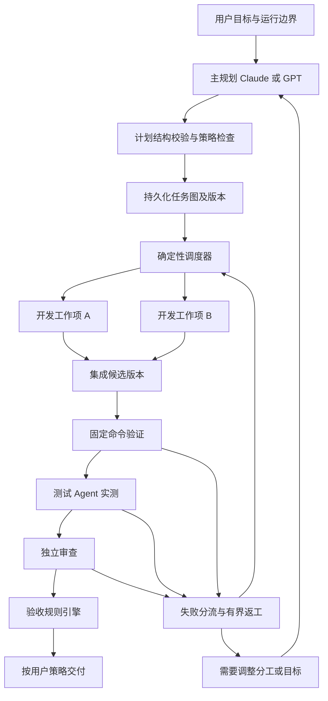

# AgentFlow 多 Agent 团队编排与验收架构设计

日期：2026-11-06（Asia/Taipei）  
状态：设计提案，供讨论与后续拆分实施；本文不代表功能已实现或实机验收通过。

> 本文保留为 v1 调研与长期功能清单。近期实施方案以 [团队执行架构 v2](./多Agent团队编排与验收架构设计_v2_2026-11-06.md) 为准；v2 补充了需求覆盖、局部重规划、角色复用、独立性约束及完成语义。

## 1. 产品目标与本轮结论

用户选择项目文件夹，输入目标，选择允许使用的 Agent、团队规模、预算和允许操作范围；系统完成规划、分工、执行、集成、实测、返工和审查，交回成果与逐项验收证据。用户可以查看进展或中途干预；正常运行不需要人工不断转发上下文。

核心决策：

1. **Claude/GPT 承担规划与必要的重规划；程序承担分发与状态推进。** 遵循用户的默认模型偏好，不把某个厂商与业务状态机绑定。
2. **任务清单是有版本的执行契约。** 每项工作明确输入、输出、依赖、负责人范围、权限和验收标准。
3. **SQLite 保存状态，事件记录变化，界面展示后端事实。** 状态栏既不是任务数据库，也不是完成依据。
4. **开发提交、集成候选版本、实测证据、审查结论分别保存。** 最终结论绑定同一个交付版本。
5. **复用现有 Rust/Tauri 基础，逐步扩展。** 本阶段不引入另一套框架接管调度、数据库和权限。

本文后续的架构与功能优先级是针对当前项目作出的设计判断；引用资料提供参考机制，不构成对本项目效果的保证。

## 2. 论文和 GitHub 调研：推荐借鉴什么

检索和读取日期：2026-11-06。检查范围为论文摘要及相关架构/失败分析章节、官方文档、仓库 README，另查看了 Magentic-One 的协调器部分源码；没有部署或运行这些外部项目。

| 资料 | 读取到的机制/结论 | 对 AgentFlow 的建议 |
|---|---|---|
| [MetaGPT 论文](https://arxiv.org/abs/2308.00352)；[仓库](https://github.com/FoundationAgents/MetaGPT) | 用角色、SOP 和中间成果组织协作 | 借鉴输入输出和交付清单；角色按任务需要配置，不强制模拟一整家软件公司 |
| [Magentic-One 论文 §4.1](https://arxiv.org/html/2411.04468v1)；[协调器源码](https://github.com/microsoft/autogen/blob/main/python/packages/autogen-agentchat/src/autogen_agentchat/teams/_group_chat/_magentic_one/_magentic_one_orchestrator.py) | 区分任务记录与进度记录，检测停滞后调整计划 | 保留进度记录和有界重规划；将日常分发改为程序调度，而不是照搬每步由模型挑选下一位发言者 |
| [LangGraph 工作流文档](https://docs.langchain.com/oss/python/langgraph/workflows-agents)；[仓库](https://github.com/langchain-ai/langgraph) | 区分预定工作流与动态 Agent，支持 orchestrator-worker 模式 | 将规划输出转换为明确的任务图；调度内核可独立验证 |
| [LangGraph 容错文档](https://docs.langchain.com/oss/python/langgraph/fault-tolerance) | 重试不等于外部操作恰好执行一次；外部写入需要幂等与结果对账 | 设计执行租约、操作标识和恢复流程，避免崩溃重试重复创建 PR 或重复合并 |
| [Microsoft Agent Framework](https://github.com/microsoft/agent-framework) | 提供图式编排、检查点、流式事件和多 Provider 等机制 | 作为图、事件和扩展接口的参考；没有必要为本地桌面控制台立即增加另一套语言运行时 |
| [OpenHands SDK](https://github.com/OpenHands/software-agent-sdk)；[Automation](https://github.com/OpenHands/automation) | 明确区分调度生命周期与执行 Agent 会话的职责 | 将调度、Provider 适配、工作环境和工具执行拆开；远程 Runner 将来可按同样边界接入。Automation README 标注 Beta，不将其当作已验证的稳定依赖 |
| [Vibe Kanban](https://github.com/BloopAI/vibe-kanban) | 产品上围绕任务、工作区、多 CLI、Diff 与预览组织操作 | 借鉴项目导入、工作区和审阅体验；这些 UI 能力不等于自动分工和验收已经解决 |
| [Why Do Multi-Agent LLM Systems Fail?](https://arxiv.org/html/2503.13657v3) | 失败包括系统设计、协作偏差和验证缺失/错误；有验证角色也可能只做表面检查 | 把提前结束、遗漏验证、错误验证、重复步骤纳入自己的回归案例；每条验收关联真实证据 |
| [Towards a Science of Scaling Agent Systems，v3](https://arxiv.org/abs/2512.08296) | 研究范围内，多 Agent 收益依赖任务结构、协调方式和模型能力，也可能增加开销 | 人数作为可用上限，允许单 Agent 路径；用自己的任务集比较效果，不套用某个基准的阈值 |

### 维护状态与证据边界

- [AutoGen 当前 README](https://github.com/microsoft/autogen/blob/main/README.md) 自述停止维护并建议新用户使用 Microsoft Agent Framework。本次 GitHub 元数据的 `archived` 字段仍为 `false`，两者存在差异：这里仅报告 README 的维护声明，不把仓库归档状态说成已确认。
- [Vibe Kanban 官方公告](https://www.vibekanban.com/blog/shutdown) 日期为 2026-04-10：原公司关闭，项目将以开源、社区维护方式继续；本地工作区仍可使用。可参考源码和设计，不能据此期待原公司持续提供服务。
- 框架 README 的能力声明、论文基准成绩，都不能替代本机 CLI 兼容检查和 AgentFlow 的真实端到端验收。
- 相关实现如将来复制、嵌入或分发，需要在选定版本上重新核对许可证和依赖；本次只形成设计，不引入第三方代码。

## 3. 当前代码中必须适配的事实

| 当前实现 | 对新设计的影响 | 本地依据 |
|---|---|---|
| 一个 Task 保存一个 developer、一个 reviewer | 单任务不能仅靠人数输入框变成团队 | `crates/contracts/src/lib.rs` 的 TaskSummary/TaskDetail |
| Planner 的首选 Provider 来自 task.developer | 主规划要有独立配置，保留旧任务行为 | `crates/orchestrator/src/planning.rs` |
| 每个任务仅允许一个 RUNNING agent_run | 同一总目标多成员并行必须修改运行归属和唯一约束 | `crates/persistence/migrations/0001_initial.sql` 的 idx_one_active_run_per_task；后续现有迁移未移除此约束 |
| daemon 按整个 Task 驱动串行阶段 | 新调度单位应下沉到可执行工作项 | `crates/daemon/src/scheduler.rs`；`crates/orchestrator/src/development.rs` |
| 审查委员会逐个等待成员返回 | 并行审查需要独立运行目录和只读环境 | `crates/orchestrator/src/review_council.rs` |
| 验证执行 project.toml 中的命令 | 有真实命令验证基础，但还缺完整的测试 Agent 协议与工作环境 | `crates/orchestrator/src/development.rs`；`execution_nodes.rs` |
| RunRole 有 Validator，但外部适配器对其结果返回 UnsupportedRole | 增加测试角色需要端到端协议接线，不能只增加 UI 文案 | `crates/contracts/src/providers.rs`；`crates/agent-adapters/src/dynamic.rs` |
| 验收表只保存种类和文字；界面用整轮验证/审查结果推导每条状态 | 必须增加逐条验收结果和证据关系 | `crates/persistence/migrations/0021_task_acceptance_criteria.sql`；`apps/desktop/src/lib/acceptance.ts` |
| 硬预算模式可为一次 run 预留全部剩余额度 | 多成员并行时需要原子地按成员分配额度，避免首个成员占满共享预算 | `crates/orchestrator/src/agent_run.rs` |
| 项目导入要求 Git 仓库 | “任意文件夹”需要未来新增工作区类型，不能宣称现在已经支持 | `crates/orchestrator/src/task_creation.rs` |
| 当前 API Provider 描述为只读审查能力，planning/development 为 false | 用户偏好的 Claude/GPT 规划可先走兼容 CLI；API 规划需单独扩展和验证 | `crates/orchestrator/src/lib.rs` 的 api_descriptor |

现有 Provider 协议、worktree、进程监管、权限代理、预算、恢复、计划版本、审核与批准封印仍可复用。本目录不含 `.git`，本次无法将本地基线绑定到提交。

## 4. 分层架构与职责



图表达逻辑流程。每个激活的图版本保持无环；返工由创建新尝试或新图版本表达，不允许 Agent 任意把数据库中的已完成节点改回运行中。

| 模块 | 负责 | 不应承担的职责 |
|---|---|---|
| 目标与计划 | 把需求变成工作项、依赖、交付物和验收条件；提出变更 | 直接更改运行状态、授权或认定最终成功 |
| 计划校验 | 校验 schema、循环依赖、输入输出、权限、预算、候选能力 | 靠自然语言猜测计划是否合法 |
| 调度器 | 找就绪节点、选择已允许的成员、预留资源、启动与恢复 | 每次分发都重新理解需求 |
| Provider Adapter | 启动指定 CLI/API 会话，翻译协议，归一化事件 | 自建另一套顶层队列和验收规则 |
| Workspace/Runner | 准备工作目录、工具、进程、端口和隔离环境 | 宣称业务验收通过 |
| 集成器 | 按依赖组装成果、产生确定的候选版本 | 把有冲突的成果直接覆盖进用户目录 |
| 验证与证据 | 运行检查、采集证据、管理逐条结果和有效性 | 把模型总结作为实际执行证据 |
| UI/通知 | 展示后端状态、提供干预入口 | 自己推进业务状态或虚构百分比 |

## 5. 核心数据模型：从一开始分清身份

保留现有 Task 作为用户可见总任务，新增 WorkItem；不把任务、Agent 与一次进程混为一个对象。

| 对象 | 含义与关键字段 |
|---|---|
| Task | 总目标、范围、交付策略、总预算、激活图版本 |
| WorkflowVersion | 不可变工作图、来源需求版本、计划/策略摘要、激活时间 |
| WorkItem | 一项可分发工作：kind、输入输出、依赖、执行契约版本、优先级、状态 |
| AgentProfile | 可复用配置：Provider、模型、推理设置、工具、角色能力、权限上限 |
| TeamMember | 本次任务中的逻辑成员；独立 member_id，可绑定相同 AgentProfile |
| RunAttempt | 一次实际尝试：work_item_id、member_id、attempt_no、租约代次、session、状态、输入摘要 |
| Artifact | 产物引用、内容摘要、来源尝试；代码提交、测试包、文档、报告均可表示 |
| Candidate | 可供测试和交付的集成版本；记录来源产物、代码/文件摘要和集成顺序 |
| AcceptanceCriterion | 一项验收条件：类型、检查方法、必需性、预期、适用范围和版本 |
| VerificationResult | 条目级结论、所测 Candidate、证据引用、执行者、检查器版本、环境 |
| Decision / ChangeRequest | 为什么变更计划、选择成员或调整范围，及其生效边界 |

“两个 Codex 成员”应拥有两个 member_id；多次重试拥有多个 attempt_id；Provider 身份保持相同。Provider 相同不等于同一 Agent 实例。

人数语义建议：界面提供“团队人数上限”和高级设置“最多同时运行人数”。主规划、开发、测试、审查等模型成员均计入团队人数；纯命令 Runner 不冒充 Agent 人数，但单独限制进程/CPU/内存/端口。成员可顺序执行多个工作项，不为每个步骤永久占用一个新成员。

## 6. 清单如何变成可执行契约

每项工作至少包含：

- 唯一 ID、工作类型、目标、完成定义。
- 明确的输入产物及其版本；不能只有“参考上一个 Agent 的聊天”。
- 依赖项与解除依赖的条件，例如依赖后端产物已获本地检查接受。
- 允许的负责人候选或能力需求，以及明确的优先顺序。
- 输出产物类型、接口约定、允许修改路径和共享资源声明。
- 自检要求、最终验收条目关联、测试命令/工具的策略引用。
- 时间/费用/Token 配额、重试与返工上限。
- 阻塞时如何报告、是否允许按已声明策略替换成员。

以下仅是候选数据形状，不是当前协议；所有示例 ID 都是占位符。

```json
{
  "schemaVersion": 1,
  "workflowVersion": 1,
  "workItemId": "frontend-1",
  "kind": "development",
  "goal": "实现登录页面并接入已约定接口",
  "dependsOn": ["api-contract-1"],
  "assignment": {
    "eligibleMembers": ["developer-a", "developer-b"],
    "requiredCapabilities": ["workspace_write", "command_execution"]
  },
  "inputs": [{"artifactId": "api-contract-output", "version": 1}],
  "outputs": [{"name": "frontend-change", "kind": "git_commit"}],
  "writeScope": ["apps/web/src/**"],
  "checklist": [
    {"id": "step-1", "text": "实现输入、提交和错误提示"},
    {"id": "step-2", "text": "补充页面测试并提交运行结果"}
  ],
  "acceptanceCriterionIds": ["login-success", "login-invalid-password"],
  "validationPolicyRef": "web-checks-v1",
  "limits": {"maxInfrastructureRetries": 2, "maxReworkRounds": 3}
}
```

清单完成状态分两类：Agent 可以报告“自述已完成”；后端依据产物与检查结果记录“已接受”。二者在 UI 中不能混用。

计划激活前校验：ID 唯一、依赖存在且无环、输入产物可获得、验收条件有负责检查者、必需能力有可用候选、修改范围不越界、预算有验证预留、共享资源有冲突策略。JSON 合法不代表这些语义条件自动成立。

保留用户原始要求到工作项和验收条目的映射；必需要求不能因为规划者漏拆而从完成门禁中消失。空验收集或零实际检查不得自动判为目标完成；确实只能人工判断的目标需显式指定人工验收方式。Agent 的自检清单与用户的最终验收清单可以关联，但不能相互替代。

## 7. 分发器：按规则执行，不重复调用模型

日常调度可表示为：

```text
读取当前激活工作图和后端事实
找出依赖已满足、未暂停、到达可重试时间的工作项
按任务公平性、优先级和稳定顺序排序
从允许的成员中筛选角色/工具/登录/兼容性/权限都满足者
在数据库事务中领取工作、预留配额、登记启动意图
事务提交后由执行器创建环境并启动进程
接收带身份和代次的事件，持久化产物，执行门禁
释放资源，更新依赖就绪状态
```

从就绪候选中选择成员，默认采用用户/规划者给出的优先列表；相同优先级使用稳定的空闲顺序。以后可以替换为基于历史的评分策略，决策仍需可解释和记录。

必须同时考虑总任务并发、成员并发、Provider/账号限流、资源限制、文件/集成锁、总预算和验证预留。没有可用成员时进入明确的等待原因，不能无限空转。

本阶段不设计任意自修改工作流语言。基础节点类型为 plan、development、command_check、integration、agent_test、review、delivery；受控条件分支和汇合由内核支持。

## 8. Claude/GPT 何时介入

| 情况 | 处理方式 |
|---|---|
| 新目标尚未拆分 | 主规划生成候选工作图 |
| 已有工作依赖刚满足 | 调度器直接分发 |
| 短暂限流、临时网络错误 | 按策略退避重试或使用已允许的后备成员 |
| 测试失败，责任和修复范围明确 | 创建对应开发项的返工尝试，传递失败证据 |
| 未预见的依赖、接口冲突、需要扩大修改范围 | 主规划提出有版本的计划变更 |
| 连续返工仍失败、同一问题重复出现 | 有界诊断与重规划，超过上限后通知用户 |
| 最终是否完成 | 验收规则引擎根据当前证据判定；模型可解释结果 |

主规划默认允许用户配置的 Claude/GPT 候选，记录实际 Provider 和模型，不写死“某品牌适合某种代码”。每轮规划输出都经过后端校验。

运行开始时固定目标版本、有效策略和团队配置。规划者只能在用户已授权的范围内调整；用户中途追加要求形成 ChangeRequest，不直接覆盖旧提示词。需求、权限或验收标准改变时，需要标明哪些工作与证据仍有效。

## 9. 多 Agent 开发与成果集成

1. 先定义共享接口/数据格式，减少前后端各自猜测。接口约定也是有版本的产物。
2. 每个写入工作项使用受管工作区；同一个工作区只允许一个有效写入尝试。将来复用目录时必须核对基线和残留。
3. 无依赖的工作项可从同一基线分叉；依赖前置成果的工作项从包含这些已接受成果的基线启动，记录输入快照。
4. 修改同一接口、依赖清单、锁文件或数据库迁移时，按预定策略串行或进入显式集成处理。路径不重叠不能证明没有逻辑冲突。
5. Agent 交回提交和产物；后端核对实际工作区、允许路径、结果身份和必要自检后才接受。
6. 集成器按拓扑顺序和稳定规则组装成果，生成 Candidate。机械合并失败时创建专门的冲突修复工作项，不静默覆盖。
7. 对 Candidate 重新构建、测试、实测和审查。两个分支各自测试通过不能替代集成验证。
8. 交付前目标分支或用户工作区变化时重新检查；若最终内容发生变化，产生新 Candidate，并更新对应验收。

集成器通常是程序；需要语义修复时才调用有明确权限的开发 Agent，修复后生成新 Candidate。

## 10. 验证设计：把“照清单验收”做实

### 10.1 验证分层

| 层次 | 负责方 | 产生什么 |
|---|---|---|
| 开发自检 | 开发成员 + 受管命令执行 | 早期反馈，不能替代独立验收 |
| 固定检查 | 命令 Runner | 构建、单测、类型检查等原始执行结果 |
| 功能实测 | 测试 Agent + 对应工具 | 按步骤启动程序、操作 UI/调用接口、记录观察与断言 |
| 独立审查 | 未参与相应开发的审查成员 | 对正确性、遗漏、风险的结构化意见 |
| 最终验收 | 规则引擎，必要时用户确认 | 对每个必需条目的当前结论 |

UI/浏览器测试必须实际具有工具、可用环境、访问地址和数据。只能读取 Diff 的 API 成员可以审查，不应被标注为已完成浏览器实测。

测试工作项要描述前置状态、操作步骤、预期结果、环境准备和清理；测试报告区分“产品失败”“环境失败”“未执行”“无法判断”。截图是观察材料，必要时结合断言、日志和接口结果，不以截图存在本身判定通过。

### 10.2 逐条证据

VerificationResult 至少绑定：criterion_id + criterion_version、candidate_id、attempt_id、输入/产物摘要、环境摘要、检查器或测试包版本、工具原始结果与 evidence_id。

- 构建条目只由对应构建检查支持，不能被一次无关命令顺带标绿。
- 行为条目由对应测试步骤与判定规则支持；主观观察可记录为 observed/unverified，不能伪装为确定性断言。
- 人工条目由用户明确确认；已允许的自动条目按既定策略推进，不重复询问。
- 结果状态至少支持 passed、failed、not_run、blocked、inconclusive、stale。
- Candidate 改变，旧结果保留但不再默认支持当前交付；第一版对新 Candidate 重跑所有最终必需检查。将来有可靠依赖映射后再优化增量复验。
- 只有审查通过或质量分足够，不能替代必需测试条目通过。

### 10.3 测试环境与独立性

受测源码保持固定版本；允许测试进程在隔离目录写入缓存、报告、临时数据。测试 Agent 新写的测试作为独立测试包保存并绑定版本；若修改了产品源码，则转成开发变更并产生新 Candidate。

测试输入、预期和必需性来自已激活的验收契约。测试 Agent 可追加探索用例和发现，但不能为了通过而删除失败条目或降低标准。复用现有完整性门禁，保留开发者修改测试/CI 的可见记录。

最终逻辑：所有必需条目对当前 Candidate 的有效结果均为 passed，且审查/交付策略满足，任务才进入“可交付”。交付操作确认成功后再记录“已交付”。未测或仅部分完成需要单独状态。

## 11. 状态、恢复与并发一致性

### 11.1 三层状态

- 总任务：草稿 → 规划 → 就绪/执行 → 验证 → 可交付 → 交付中 → 已交付；另有等待用户、暂停、失败、取消。总体进度是子项事实的投影，不能简单用“最后一个 run 成功”推导。
- WorkItem：pending → ready → running → submitted → checking → accepted；另有 waiting_input、blocked、failed、cancelled、superseded。未被接受的输出不解除依赖。
- RunAttempt：reserved → starting → running → succeeded/failed/timed_out/interrupted/cancelled。进程成功只说明尝试正常结束，业务工作项仍需检查。

暂停支持两种明确语义：暂停派发让现有尝试收尾；立即停止则取消进程并保存恢复点。取消总任务要取消全部子项、进程、开发服务器和租约。

### 11.2 必须遵守的不变量

1. 同一个工作项只存在一个有效写入尝试；不同工作项可以并行。
2. 每次领取工作有 lease_token/代次，领取、预算预留和启动意图在一个事务中完成。
3. 旧代次事件不能改变新尝试状态或解除新尝试的资源。事件写入做幂等去重。
4. 取消、暂停、计划替换等决定使用版本检查；晚到的成功不能复活已取消工作。
5. 租约过期不等于旧进程已停止。重分配写入工作前须确认进程已结束；确认不了则隔离旧环境并阻断发布，不能在原目录直接起第二个写入者。
6. Git ref 更新、合并、创建 PR 等副作用有稳定 operation_id 和恢复记录。丢失回应时先查询真实状态，再决定是否重试。
7. 文件产物可先写临时位置、校验摘要后登记；崩溃遗留由恢复流程核对。数据库事务不能假装覆盖磁盘或外部服务。
8. 共享预算按尝试原子预留，退回未消耗部分；给验证/返工预留配额。未知消耗继续显示未知，硬限制与软限制保留区别。
9. 计划版本、输入摘要、权限有效范围改变时，旧结果只进入历史，不能直接接入新图。
10. 恢复先区分“已完成未登记”“仍在运行”“确定失败”“结果未知”，避免整任务盲目重跑。

推荐在现有 SQLite 事务和 task_operations/saga 思路上增加启动意图或 outbox、工作项租约和恢复对账。它提供可恢复的处理边界，不承诺所有外部动作具有 exactly-once 保证。此原则与 [LangGraph 容错文档](https://docs.langchain.com/oss/python/langgraph/fault-tolerance) 对重试和外部副作用的区分一致。

## 12. 协作上下文：交换成果与问题

第一版只需要四种有类型的交接：产物已提交、需要输入、发现问题、请求变更。接收对象是工作项/角色，不依赖某个会话永远在线。

- ContextBundle 包含当前契约、依赖产物、接口定义、相关失败证据、已确认决定和来源；不广播全员完整聊天。
- Issue 绑定验收条目、Candidate、复现步骤、严重程度和负责工作项；修复报告不能自行关闭 Issue，复验结果才能关闭。
- 可共享事实、约定和已批准决定；猜测与已证实事实分开。
- 项目内文档、网页、测试日志、Agent 消息都是输入材料，不能直接变成调度授权或覆盖用户目标。
- 会话可继续使用，但输入和产物才是权威；会话丢失后可重建上下文。
- 项目记忆有来源、适用范围和过期条件。向量检索、跨项目长期学习放在后期，不作为调度内核前提。

## 13. 用户界面与自主程度

创建任务的基本操作保持简单：选择文件夹 → 目标/验收 → 主规划 Claude/GPT → 允许的成员与人数上限 → 运行。

高级配置再提供并发上限、预算、网络/安装范围、验证环境和交付策略。安装向导区分已安装、已登录、版本兼容、角色/工具探针成功；提醒安装和登录并复检，不只检查 PATH 中有命令。

任务页以总目标、成员当前工作、依赖等待、交付版本和验收条目为中心；详情再展示日志和完整事件。例：

```text
目标：完成登录功能
开发 A：表单与错误提示，产物已提交
开发 B：接口实现，本地检查中
测试成员：等待集成候选版本
审查成员：等待实测完成
验收：当前候选通过 2/5；未测 3 项
下一步：接口检查通过后自动集成
```

状态展示不推测百分比或不可靠 ETA。提供暂停派发、立即停止、替换成员、补充信息、查看计划变化、重跑指定检查等入口；每个操作说明影响哪些工作。

自主程度是任务策略：

- 辅助：用户确认计划及最终交付。
- 托管：在开始时确定的目标与权限内自动执行、返工和替换成员；仅遇到必要缺失信息或越界变化时请求用户。
- 自动交付：用户预先明确允许某类目标分支/交付动作后，按证据门禁执行；与“自动开发”分开设置。

同一授权范围内的正常动作不反复确认。完成、失败、需要用户决定是默认通知时机；日常状态更新留在软件内。

## 14. 可维护、可扩展的实现边界

优先建立逻辑模块边界，代码规模需要时再拆 crate：

| 边界 | 建议放置/复用 | 允许扩展的内容 |
|---|---|---|
| 领域契约 | contracts | Task/WorkItem/Attempt/Artifact/Verification DTO、schema 版本 |
| 状态与就绪规则 | workflow | 纯状态转换、依赖检查、完成门禁；不访问 CLI |
| 团队执行协调 | orchestrator | 调用模块、分发、返工、集成和恢复；按职责拆模块 |
| 持久化 | persistence | 迁移、事务、租约、预算预留、事件与查询投影 |
| 厂商适配 | agent-adapters/provider-protocol | CLI/API 参数、认证、模型配置、结构化结果、能力协商 |
| 工作环境 | git-engine、process-supervisor、执行节点 | Git/普通文件快照、进程、工具、远程节点 |
| 验证 | 新增独立逻辑模块 | 命令、接口、浏览器、文档等检查器和证据归档 |
| 展示 | desktop | 读取统一 DTO/事件，调用明确命令 |

扩展点至少包括 ProviderAdapter、WorkspaceBackend、Runner、Verifier、AssignmentPolicy、ArtifactStore。仅为实际需要的实现建立接口，不先做无限插件平台。

Provider、工具、工作流模板是三类扩展：接新 CLI 不改验收引擎；加浏览器测试不改调度状态机；加工作流模板不复制执行器。

协议变更需要 schema/能力协商、旧字段默认值和契约测试。现有外部协议为 1.3/1.2，加入 tester 结果或新的强制身份字段时必须显式协商；旧 sidecar 不支持就不调度该角色，不能把它谎称为兼容。

任务开始保存配置快照；改变全局设置不偷偷改变运行中任务。拒绝把关键状态藏在 prompt、前端 store 或 Agent 私有会话里。

权限需要区分读取范围、写入范围、可运行命令、网络目标、凭据和副作用。CLI 在本机启动并不等于模型在本机推理；Provider 向外部模型发送哪些内容，应在任务策略和能力说明中表达。优先复用 CLI 自身登录，API 凭据继续由凭据存储管理，不复制登录令牌到任务或成员记录。数据脱敏、日志导出和证据保留沿用同一策略边界。

## 15. 功能清单与分期

标记：已有基础表示看到了代码，但不等于本轮进行了实机验收；扩展表示现有模块需改造；新增表示当前未发现完整路径。

### 阶段 A：先固定契约与核心行为

| 功能 | 当前基础 | 必须确定的设计 |
|---|---|---|
| 独立主规划 | 扩展 | Claude/GPT 配置与规划输出 schema |
| 团队及同 Provider 多实例 | 新增 | 成员身份、人数和并发含义、配置快照 |
| 工作项、依赖与版本 | 新增 | DAG、输入输出、变更生效规则 |
| 条目级验收与证据 | 扩展 | 每条结果、候选版本和证据有效性 |
| 状态/事件/取消/恢复契约 | 扩展 | 租约、去重、旧事件拒绝和副作用对账 |
| 新旧流程并存 | 新增 | 旧单开发流程保留，新模式显式开启 |

### 阶段 B：最小团队闭环，第一版实现目标

| 功能 | 当前基础 | 完成要求 |
|---|---|---|
| 团队预检与安装引导 | 扩展 | 所需角色和工具均检查，缺失时可恢复 |
| 确定性分发 | 扩展 | 成员/Provider/任务/资源限额同时生效 |
| 多工作区开发 | 扩展 | 两个开发项并行、相同 CLI 可多实例 |
| 集成候选版本 | 新增 | 来源、顺序、冲突处理、集成后验证 |
| 测试 Agent 与测试工具 | 新增 | 至少一种真实 API 或浏览器实测路径 |
| 定向返工与复验 | 扩展 | 失败项有负责人、有上限、新版本重验 |
| 独立审查与最终门禁 | 扩展 | 审查和测试均绑定当前候选 |
| 进度栏与通知 | 扩展 | 后端事实、等待原因、唯一下一步 |
| 本地批准与交付 | 已有基础 | 复用批准封印，交付新候选前核对有效性 |

### 阶段 C：长时间托管所需能力

| 功能 | 当前基础 | 需要补齐 |
|---|---|---|
| 守护进程与崩溃接管 | 已有基础 | 子项级恢复、对账、资源回收 |
| 预算与额度管理 | 已有基础 | 原子共享预留、验证预留、未知费用展示 |
| 限流/登录过期/版本漂移 | 已有基础 | 团队级影响范围和重检恢复 |
| 端口、浏览器和测试数据管理 | 新增 | 并行冲突、健康检查、清理、隔离会话 |
| 运行中追加要求与替换成员 | 扩展 | 计划差异、输入失效、可继续工作的范围 |
| 上下文交接、Issue 生命周期 | 扩展 | 产物版本、定向通知、复验关闭 |
| 停滞与质量退化处理 | 已有基础 | 团队层检测、有界重规划 |
| 报告、备份和可复验包 | 已有基础 | 团队/证据导出、脱敏、证据保留策略 |
| 硬盘、CPU、内存和磁盘配额 | 扩展 | 运行前预检和运行中资源上限 |
| CLI 内部子 Agent 约束 | 新增 | 防止隐藏嵌套并行绕过团队上限；无法管控的 Provider 明示限制，默认不开放受控模式下的内部再分派 |

### 阶段 D：扩展到更多任务和执行环境

| 功能 | 为什么需要 | 推荐时机 |
|---|---|---|
| 普通文件夹工作区 | 文档、资料整理、数据任务不一定有 Git | 软件开发团队闭环稳定后；基于拷贝/快照和差异交付，不强制给用户目录 git init |
| 文档/表格/数据/研究检查器 | 非代码成果有不同验收方式 | 每引入一种成果类型同时实现对应证据规则 |
| 工作流和团队模板 | 重复任务可复用配置 | 稳定契约之后；模板有版本和兼容范围 |
| 人工清单导入、自动拆分、计划编辑 | 满足不同熟练度用户 | 基础任务图可用后 |
| 本地、SSH、容器、远程 Runner | 大项目/特殊工具不一定在桌面运行 | 统一 Runner/环境身份成熟后 |
| 多仓库、多服务集成 | 前后端或服务可能分仓 | 单仓集成可靠后；候选要记录多个仓库版本 |
| MCP/其他工具协议 | 复用工具生态 | 在工具能力与权限边界内接入；不让工具协议替代工作流和验收协议 |
| 外部 Agent 协议与能力发现 | 接入未来 Agent 或远程执行者 | 有真实接入对象时适配，保留本地协议边界 |
| 项目知识和检索 | 长任务减少重复调查 | 有来源、版本和失效机制之后 |
| 自动推荐成员与规模 | 用历史改善分工和预算 | 有足量可比任务和可靠用量数据之后 |
| 跨平台与正式分发 | 其他用户需要稳定安装与升级 | 明确目标平台，增加安装版 E2E、签名/更新/迁移回滚 |
| API/CLI/无头入口 | 接 CI、编辑器、其他控制台 | 共享后端命令与事件协议，不复制业务逻辑 |
| 定时任务与事件触发 | 周期维护或 Issue/CI 驱动 | 单次托管可靠之后，复用同一任务内核 |

### 阶段 E：多人和组织场景，预留边界后按需求建设

- 多用户身份、项目访问控制、密钥隔离、审批责任和审计归属。
- 团队共享模板、版本策略、管理员限制、配额与任务公平调度。
- 远程控制和移动端查看；访问认证、会话吊销与数据边界。
- 多机器调度、远程节点租约、制品存储和环境一致性。
- 工作流/Provider 插件分发、签名、升级、兼容性和回滚。
- 成功率、返工、耗时、成本与等待原因的运营面板；仅在数据完整且口径明确时比较成员表现。

本地 SQLite 和 daemon 足够承载第一阶段设计；多人/多机需要重新评估共享数据库、认证和调度一致性，不能把本地锁直接当成分布式锁。

## 16. 迁移顺序与验收场景

### 16.1 按兼容路径增量实施

1. 写入 ADR：身份模型、任务图、完成语义、证据绑定、取消/恢复与权限边界。先确定不变量，不冻结所有未来插件细节。
2. 新增 WorkItem、版本、依赖、成员、证据和候选表；旧 Task/旧事件保持可读，不伪造历史子任务和验收证据。
3. 给 agent_runs、events、permissions、operations 增加新运行归属。将“每 Task 一个 RUNNING”约束拆为旧模式约束和新模式下每可执行工作项的有效尝试约束；不能直接删除唯一约束而不补替代规则。
4. 改造 run_agent，使其从明确执行上下文取工作目录、输入、租约和配额；取消/恢复从总任务下发到全部尝试。
5. 先用固定计划和确定性测试执行器验证并行、取消、崩溃和证据失效，再接 Claude/GPT 生成计划。
6. 接入集成、真实命令验证、测试 Agent、独立审查与最终交付；前端同步增加事实查询和干预入口。
7. 新模式通过功能开关显式启用；先完成真实小任务闭环，再扩大任务规模。数据库迁移有备份和失败恢复；新数据写入后不能假定旧二进制可直接读取。

### 16.2 必需的验收样本

- 两个开发成员同时完成不同工作项；同 Provider 的两个成员身份和资源分别记录。
- 依赖成果未接受时，下游不启动；前置版本改变时旧输入不被复用。
- 故意产生接口冲突，系统能够进入集成修复，生成新候选并重新测试。
- 开发者报告“完成”但遗漏一条需求，测试结果阻止最终成功。
- 总体测试通过但其中一条行为没有执行，界面仍显示该条未测。
- 老候选测试通过后代码再次改变，旧证据不能批准新候选。
- 一成员登录过期或限流，只按策略影响相关工作，不把全队进度标为成功或全部重跑。
- daemon 在启动前后、产物登记前后、创建 PR 回应前后中断，恢复后不会盲目重复副作用。
- 租约过期、旧进程晚到成功、重复事件、取消与完成同时发生，均不能复活或覆盖新尝试。
- 并行预算预留不超出共享上限，验证仍有预留额度；费用未知不显示为零。
- 测试环境起不来与产品断言失败分开；测试服务、浏览器和端口在取消后清理。
- 旧单 Agent 流程、旧数据库和旧 Provider 协议回归通过。

用相同任务、相同验收、可比预算，对比“单开发成员”和“团队模式”，记录成功/未测/阻塞、耗时、费用和返工。先建立自己的有效基线，再决定哪些任务默认开启多 Agent。

## 17. 建议首先定下的设计决定

1. 主规划默认候选 Claude/GPT；分发和完成判定由程序负责。
2. 第一版聚焦单个 Git 项目；为普通文件夹预留 WorkspaceBackend。
3. 用户设置人数上限，成员与 Provider 分开；高级设置单独控制同时运行上限。
4. Task 为总目标，WorkItem 为调度单位，RunAttempt 为执行单位；版本与尝试不复用身份。
5. 清单、依赖、输入输出、验收与权限都结构化；Agent 只提交结果和变更提案。
6. 集成候选版本是统一测试与交付对象；每条验收有独立证据。
7. 默认采用明确的分阶段开发/集成/测试/审查；扩展通过节点、适配器和检查器实现。
8. 并发、恢复、预算和事件代次与功能一起实现，不能留到界面做好后再补。

这些决定构成近期应稳定的核心契约；模型供应商、团队模板、任务类型和部署方式可以围绕这些边界继续扩展。
