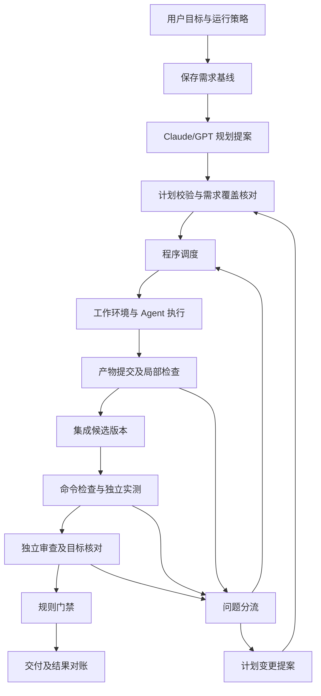

# AgentFlow 团队执行架构 v2

日期：2026-11-06（Asia/Taipei）  
状态：实施契约；替代 v1 中的近期实施建议。已开展增量实现与分层验证，当前完成边界和阻塞见 [实施记录](./团队执行_实施记录_2026-11-06.md)；本文不代表 M0—M4 或正式安装版已整体验收。  
适用目标：用户选择项目、输入目标和运行范围，选定可用 Agent 与人数，系统持续执行并交回可检查的成果。

## 1. 本版首先确定的设计

1. **Claude/GPT 负责规划、解释问题和必要的重规划；分发器是确定性程序。** 主规划不是每一步都在线的裁判。
2. **原始需求、执行清单、验收清单分别保存并关联。** 开发清单完成，不能直接推出原始目标完成。
3. **角色、团队席位、Provider 和执行尝试分开。** 用户控制团队规模；系统按能力和独立性规则安排职责。
4. **工作项的产物通过局部检查后可供下游使用；最终目标由集成后的验证判定。** 局部接受与最终验收使用不同状态。
5. **普通返工、故障重试、计划变更使用不同机制。** 成功且输入仍有效的工作保留；只有受影响工作需要停下或重做。
6. **最终验收绑定不可变候选版本、需求/验收版本和证据。** 交付的内容必须与这些证据对应。
7. **第一版聚焦本机单个 Git 项目的开发任务。** 核心数据模型允许诊断报告、无需修改等产物；普通文件夹和远程集群暂缓实现。
8. **在现有 Rust/Tauri/SQLite 项目中增量建设。** 不新增微服务、第二套调度框架或完整事件溯源平台。

稳定的是这些契约及其不变量；模型、团队模板、工作项种类和执行环境可以后续扩展。前期设计不试图提前固定所有未来功能。

## 2. 对 v1 的实际修订

| v1 中需要收紧的地方 | v2 的明确规则 |
|---|---|
| 需求覆盖只有原则，缺少独立处理路径 | 增加 Requirement 与 Coverage；测试职责在开发前核对需求覆盖，交付前核对实际结果 |
| 工作图版本变化可能让所有旧结果失效，与局部重规划冲突 | 工作图记录编排历史；工作项规范摘要和输入摘要决定成果可否继续使用 |
| 角色容易被理解为固定人数与常驻进程 | 角色是职责；人数限制逻辑席位，运行限制实际尝试；允许兼任但检查独立性 |
| 返工与重试边界不够具体 | 区分基础设施重试、产品修复、结果协议修复、计划修订和结果未知对账 |
| 任意分支产物如何集成不够具体 | 产物记录输入基线与变更增量；稳定顺序集成，避免重复应用依赖改动 |
| 独立审查只考虑一个实际开发者 | 审查候选必须考虑所有实际源码贡献者及相应厂商家族，包含 fallback 和集成修复 |
| “所有节点成功”与“交付成功”边界不够具体 | 最终门禁直接检查需求覆盖、逐条证据、阻塞问题与交付策略，不依赖节点计数或质量分 |
| 扩展能力列表较多，容易把第一版做成平台工程 | 按可验收里程碑逐步实现，扩展只保留确有需要的接口 |

本版沿用 v1 已读取的研究依据，不增加新的论文效果或框架维护状态结论。调研范围、日期和维护状态差异见 [v1 调研记录](./多Agent团队编排与验收架构设计_2026-11-06.md)。

## 3. 用户实际怎样使用

### 3.1 创建任务

基本界面只要求用户提供：

- 项目文件夹。
- 想实现的目标，可附必须满足的条件。
- 允许使用的 CLI/Profile，以及主规划候选：用户配置的 Claude/GPT。
- 团队人数上限。
- 运行策略：预算、允许操作范围、是否确认计划、最终交付方式；支持复用项目默认值。

高级设置再提供同时运行上限、成员偏好、测试环境、独立性策略等。用户可以自行指定成员职责，也可以让主规划在允许范围内推荐。

系统预检安装、登录、版本、结构化输出和本次所需工具；明确告诉用户缺少哪个角色或工具，并提供安装/登录后的重检入口。不会只因命令存在就显示“可运行”。

### 3.2 启动后的行为

系统形成任务计划与验收覆盖关系，在用户已选择的自主策略内激活。常规分发、检查、限流重试、已知问题返工自动推进；需要用户补充关键事实、改变原始目标或扩大授权时才请求决定。

用户随时能看到：哪个成员正在做什么、等待什么、当前测试的是哪个版本、哪些要求已验证、接下来会自动发生什么。默认只在完成、失败、需要用户处理时通知。

### 3.3 人数的准确含义

- `teamCapacity`：同一任务可用的逻辑成员席位上限，包含规划/开发/测试/审查成员。
- `maxConcurrentAttempts`：同时执行的受管 Agent 尝试上限，不大于可用席位数；命令执行器另有限额。
- Profile 是配置，成员是本次任务的席位，Attempt 是一次会话/进程尝试。两个成员可以使用同一 CLI/Profile。
- 一个成员可顺序承担不同职责；重新启动或替换 Provider 使用原席位并保留绑定历史，不靠不停新建成员绕过人数上限。
- 同一成员同一时间只执行一个 Agent 尝试。重试与故障修复仍占用席位和预算。
- 纯命令 Runner 不计为 Agent 成员，但占进程、CPU、内存、端口和执行限额。
- CLI 内部不受管的子 Agent 可能绕过外层计数。受控模式需禁用这种再分派，或接入可追踪的子运行；不能管控时明确说明外层限制只覆盖受管运行。

四席位示例：A 规划并在后期审查，B/C 分别开发，D 独立实测。A 只有满足审查独立性时才能兼任；如果 A 参与了源码修改，审查资格必须重新计算。人数不足时预检给出可行分工或说明无法满足当前策略，不悄悄增加成员或降低标准。

## 4. 总体结构：六个职责模块



这是控制流程图，不是可执行 DAG。具体工作图的每一版保持无环；返工、条件分支和重规划由明确的状态转换与新规范版本表达。

| 模块 | 输入 | 输出与职责 |
|---|---|---|
| 目标与计划 | 原始需求、仓库概况、允许成员和策略 | 需求映射、计划或变更提案；没有直接授权和改状态权限 |
| 工作流内核 | 已激活契约、后端事实、事件 | 状态转换、就绪集合、失效与门禁判断；不调用模型 |
| 调度与恢复 | 就绪集合、额度、资源与能力 | 原子领取、启动意图、取消、恢复对账 |
| 执行与适配 | 明确的尝试上下文 | CLI/API 会话、受管工具、产物与事件；不自建顶层调度 |
| 集成与验证 | 产物、候选、验收契约 | 集成版本、真实检查结果、证据和问题 |
| 界面与交付 | 后端查询、明确操作指令 | 状态展示、用户干预、按已选策略交付；不从聊天推断成功 |

代码先建立模块边界，再按规模拆 crate。保持 SQLite 关系记录为事实来源；状态修改和审计事件在同一事务提交。事件用于审计与界面续接，本版不要求从头回放所有事件才能恢复系统。

## 5. 需求、清单、验收分成三层

### 5.1 需求基线 Requirement

保存用户原话、附件来源和后续明确修订。Requirement 包含稳定 ID、原文位置/来源、解释、必需性、版本以及尚未确认的假设。

主规划可以提取和解释需求，但提取结果不能替代原文。低影响假设在既定策略允许时记录后继续；影响最终用途、数据格式或交付范围且无法可靠推断的歧义需要用户信息，不能靠换个模型自行拍板。

### 5.2 执行清单 WorkItem

表示为了实现要求需要做的工作。每项明确输入、输出、依赖、候选成员、读写范围、局部检查和失败处理。Agent 可报告进度和提交产物；“已接受”由后端确认。

调查报告、实现变更、测试包、审查报告都可以作为产物。没有修改源码并不自动失败：确认需求原本已满足时，提交现状证据并进入相应验收；没有证据的“无需改动”不能直接通过。

### 5.3 最终验收 AcceptanceCriterion

每条声明对应哪些需求、验证方式、预期、必需性和适用版本。Coverage 将需求关联到工作项与验收条目；允许一对多、多对一，但不能漏掉必需要求。

在开发前，由测试职责核对原文、提取需求和验收是否一致；交付前再核对当前成果。复用测试成员，不新增一个永久常驻的“需求管理员”。

**程序只能检查映射是否存在、引用是否完整，无法证明自然语言需求已经被完整理解。** 语义核对、明确预期、真实行为测试降低遗漏风险；仍无法判断的要求保持待确认。主规划和验证模型可能共同误解，不能把覆盖表当成正确性证明。

## 6. 数据模型与权威关系

| 对象 | 最低必要内容 |
|---|---|
| Task | 用户目标、需求基线引用、有效策略、预算、当前计划引用、总体状态 |
| Requirement / Coverage | 原始要求、来源与版本，工作项/验收对应关系，覆盖核对记录 |
| PlanRevision | 不可变编排清单、工作项规范引用、变更原因、激活记录 |
| WorkItem / WorkItemSpec | 稳定工作 ID、不可变规范版本/摘要、依赖、输入输出、局部检查、状态 |
| TeamMember / ProfileBinding | 席位、角色资格、Profile 配置快照、厂商/模型、绑定历史 |
| RunAttempt | 工作项及规范摘要、输入摘要、成员、尝试号、租约代次、会话/进程和结果 |
| Artifact | 类型、内容摘要、来源尝试、输入基线、产物位置、局部检查记录 |
| Candidate | 集成内容、来源产物清单、基线、Git commit/tree 或制品摘要 |
| Criterion / VerificationResult / Evidence | 验收契约及版本、受测候选、真实执行及环境、证据、判定来源 |
| Issue / ChangeSet / Operation | 失败与责任、计划变更及影响范围、副作用意图/回执/对账状态 |

这些是逻辑对象，不要求每个都成为新表或独立服务；实际 SQL 设计在下一阶段按查询和事务需要确定。已有 revisions、artifacts、reviews、operations、events 尽量复用，不能在两套表中各保存一个可独立修改的“当前真相”。

`specHash` 与 `inputManifestHash` 来自固定序列化规则；输入清单包含产物摘要、接口/配置/测试策略等实际影响项，不能只计算提示词文本。保存 schema 版本，避免升级后相同对象被不同方式计算摘要。

## 7. 分发规则与工作项状态

程序仅分发满足以下条件的工作项：

1. 工作项规范仍由激活计划引用，且没有暂停、取消或待处理的变更。
2. 依赖产物已经局部接受，指定输入版本已经存在。
3. 至少一个允许成员满足角色、工具、认证、版本和独立性规则。
4. 席位、Provider/账号额度、全局并发、环境资源和预算可用。
5. 不存在同一工作项的有效尝试，不与工作区写入或集成锁冲突。

默认按任务公平性、优先级和稳定就绪顺序调度；成员按用户/计划给出的优先列表选择。同等条件使用稳定顺序。本版不引入学习型选人或每次调用模型路由。

```text
pending → ready → active → submitted → output_accepted
                      ↘ waiting_input / waiting_resource / blocked
                      ↘ failed / cancelled / superseded
```

`output_accepted` 表示产物满足该工作项的交付契约，可以给下游使用；不表示总目标已完成。Attempt 的进程成功、工作项的产物接受、最终验收成功是三种不同事实。

一轮失败可以创建新的 Attempt；达到局部检查后下游就绪。修复一个已接受产物时创建新规范/修复工作项并保留旧产物，不能直接覆盖它让下游看不到版本变化。

## 8. 五类异常，五种处理方式

| 类别 | 典型情况 | 处理与上限 |
|---|---|---|
| 基础设施重试 | 限流、临时网络错误、可恢复工具故障 | 相同工作契约，新的 Attempt；退避和有限后备链；复用前先检查输入与残留 |
| 产品返工 | 测试断言失败、实现遗漏、审查指出确定问题 | Issue 带证据交回对应开发工作；产生新产物与候选，按返工配额执行 |
| 协议修复 | CLI 正常结束但结构化结果不合法 | 有限的结果修复尝试，记录消耗；不得把无法解析结果当成功 |
| 计划修订 | 出现新依赖、接口方案不成立、责任不明确 | 主规划生成 ChangeSet，经影响分析和策略校验后激活 |
| 结果未知对账 | 进程/网络中断，无法确定是否已完成外部操作 | 先查询真实状态；不能直接当作失败重试或当作成功继续 |

产品返工按需求/Issue 记录累计轮数，基础设施重试按操作记录累计；新建工作项、换计划或换 Provider 不能清空总体返工/预算上限。同一 Issue 反复出现或进度停滞时进入有界诊断；超过总任务阈值后停止并给出可操作原因。

## 9. 计划怎样改变而不推翻所有成果

ChangeSet 必须基于当前已知计划版本，声明：新增/替换/取消哪些工作项、理由、需求和验收变化、资源/权限变化，以及建议复用的成果。

激活流程：

1. 校验基准版本，拒绝基于过期计划的覆盖更新。
2. 从变动输入、接口、写入范围和依赖计算影响集合；无可靠依赖信息的相关范围采取保守失效。
3. 暂停受影响节点和后继的派发；对正在写入的受影响尝试发出取消，确认退出或隔离旧环境。
4. 后端根据实际规范和输入摘要核对复用关系；模型不能仅凭“无影响”三个字保留成果。
5. 在事务中激活新计划，记录不变节点的继续关系、替换节点的版本和撤销的尝试代次。
6. 不变工作可以继续，受影响工作从已接受且有效的检查点执行。最终候选或验收基线变化时重新完成最终验证。

**计划总版本号只记录编排历史，不能单独决定 Attempt 是否过期。** 一次旧计划下启动的工作，如果工作项规范、输入、权限和有效代次均未变，且新计划显式保留它，可以完成并提交。工作项规范或输入改变时，旧结果只能留作历史材料。

在已选范围内调整先后、替换后备成员和修复缺陷可自动激活。删除用户必需要求、降低验收标准、扩大权限或改变交付目标，不能由模型自行激活；遵循用户事先选择的范围或获取相应决定。

首版重规划采用阶段边界：暂停派发、明确受影响项、切换计划后继续；不实现对任意执行中节点的透明热替换。

## 10. 开发产物与集成：先解决版本关系

- 每个写入 Attempt 使用独立的受管工作环境，记录精确输入基线；只有持有效租约的执行器能登记产物和发布成果。
- 后端验证声明输出与实际改动一致、位于允许范围内、局部检查执行过。Agent 的路径声明是策略输入，不等于操作系统已经实施隔离；选定 CLI 的沙箱保证必须实际探测并展示。
- 代码 Artifact 记录 `inputBaseSha`、`resultSha`、变更增量和来源；包含前置改动的完整分支不能再次把前置提交重复应用。
- 无依赖工作项可从共同基线分叉；有依赖工作项从包含指定依赖产物的已记录基线启动。输入准备本身也是受管操作。
- 集成操作按拓扑和稳定规则串行执行，记录已应用的产物；新 Candidate 不覆盖旧 Candidate。
- 接口、依赖清单、锁文件、数据库迁移等共享变更需声明；无法预判的语义冲突通过集成检查和实测发现。
- 机械合并失败就创建集成修复工作，交给允许写入的开发成员；集成修复成员计入实际源码贡献者。
- 返工默认以当前失败 Candidate 为已记录输入，提交相对于它的修复增量，保留其他已集成改动。不能回到最初分支修完后覆盖其他人的成果。

首版仅支持一个项目同时一个集成/最终交付操作；开发可并行。该串行点可能成为瓶颈，先测量真实冲突和等待情况，再决定是否扩展多集成通道。

## 11. 验收怎样避免“全绿但没做完”

### 11.1 四种不同检查

| 检查 | 主要职责 | 有效性边界 |
|---|---|---|
| 需求覆盖核对 | 测试职责对照原文、计划和验收条目，指出遗漏和歧义 | 语义判断可能出错；无法确定时记录，不伪造确定性 |
| 固定命令检查 | Runner 真实运行构建、类型检查、测试等 | 只证明配置的检查对当前输入得到对应结果 |
| 独立实测 | 测试成员执行用户流程、接口请求或探索测试 | 必须有工具、可启动的程序、前置数据和具体预期；记录范围与未测项 |
| 独立审查 | 评估遗漏、错误、风险和阻塞 Issue | 审查票数和质量分不能替代必需实测 |

首版至少实现一种真实实测通道，例如本地 HTTP API 或浏览器工作流；另一种未实现的通道不得显示为可用。只读 API 模型可以参与文本审查，不能被当作自动拥有终端/浏览器工具的测试执行者。

### 11.2 检查计划与证据

Criterion 除文字外，包含受测要求、前置状态、操作步骤/命令引用、预期、判定方法和必需性。工具实际执行由 Runner 采集，Agent 提交证据引用及解释；伪造路径、缺失运行或不匹配快照不能被接受。

Evidence 绑定 Candidate、执行身份、工具/测试包版本、输入与环境摘要、原始结果和内容摘要。VerificationResult 明确判定来源：规则、Agent 观察或人工决定。主观条目可按用户事先选定规则接受 Agent 判断，但界面和报告必须标明该证据等级，不伪装成确定性断言。

条目状态：`not_run`、`passed`、`failed`、`blocked`、`inconclusive`；结果是否仍适用由独立的有效性字段表达，失效显示 `stale`。环境起不来、断言失败、没有测试和无法判断分别记录。

截图、日志、自然语言报告是不同材料，不能因文件存在就自动通过。测试成员可增加探索用例，但删除必需用例、放宽预期必须走需求/验收变更。

受测源码保持固定，允许测试在隔离目录产生缓存和报告。新测试保存为有版本测试包；如果测试成员修改产品代码，视作开发变更，新建 Candidate，并重新计算其独立验证资格。

### 11.3 独立性必须可满足

- 测试成员不能是被测源码的实际贡献者；测试会话不依赖开发者“已经通过”的结论作为预期来源。
- 审查检查实际贡献者全集，包括后备开发者与集成修复者，不只看最初配置的 developer 字段。
- 现有跨厂商审查策略保持有效。若代码同时由两个厂商家族贡献，且只有这两个家族可审查，严格策略可能无解；规划与 fallback 必须预先考虑这种约束。
- 现有针对测试、CI、权限或安全控制面等敏感变更的委员会门禁继续适用；所需独立成员数和厂商组合一并检查。四席位示例仅在满足全部适用策略时成立，不保证任何任务都能用四席位完成。
- 可行办法是将一个家族留作审查、使用额外符合条件的候选，或在创建任务时明确选择其他独立性策略。不能靠换一个 member_id 冒充跨厂商独立。
- 后期如支持不同独立性策略，须保存策略版本和实际保证；旧任务和严格模式不能被自动降级。

预检能检查候选和分工是否存在可行组合，不能保证未来登录/额度始终可用。fallback 会改变实际贡献者，因此每次切换后、开始审查前都重新校验资格。

### 11.4 最终完成门禁

程序依次检查：

1. 当前原始需求基线存在，必需要求均有验收映射，必要的语义覆盖核对已经执行。
2. 当前 Candidate 已封存，所有必需产物和来源可追踪。
3. 每个必需条目对当前 Candidate、当前验收版本都有有效且允许类型的通过结果；零检查或未测不能自动通过。
4. 必需固定检查、独立审查及适用独立性策略满足，没有未解决的阻塞 Issue。
5. 当前交付策略与授权适用，交付前版本核对满足。

全部满足才进入 `ready_for_delivery`。交付操作已确认才为 `delivered`。`delivered` 表示已知范围的门禁与交付成立，不宣称软件没有未知缺陷。

Candidate 内容、验收基线、测试包或相关配置变更时，首版重新运行所有最终必需检查；保留不变的开发产物，不做复杂的增量测试推断。

## 12. 恢复、预算与副作用的最低规则

### 12.1 启动与事件

领取工作、预留席位/预算、生成 Attempt 和启动意图在一个事务完成。事务外由执行器启动；恢复流程核对尚未完成的意图，不能在持有数据库事务时等待 CLI 或网络。

结果接受至少核对：task_id、work_item_id、spec_hash、input_manifest_hash、attempt_id、lease_epoch、有效成员绑定与取消/替换状态。事件有可去重的事件身份和后端顺序游标；跨成员时间戳不作为因果依据。

租约到期不证明旧进程停止。先确认进程身份及其进程组退出；不能确认时隔离旧环境，禁止发布到当前候选，在未收回资源前不假装席位和机器额度已空闲。新尝试不会与未知旧写入者共用目录。

暂停派发允许当前工作收尾；立即停止取消当前进程并保存恢复点。取消 Task 覆盖全部子项和受管服务；晚到事件只能留审计，不能让任务复活。

### 12.2 配额

共享预算按尝试原子预留，所有重试和返工计入；预留中包含后续必需验证与修复空间。不能让第一个 Agent 占用全部剩余额度。

未知 Token/费用继续显示未知。硬限制只在所用 Provider 支持实际约束时提供；软限制、估计和外部订阅额度分别展示。无法获得准确额度时不承诺绝不超费，可采用时间/运行次数上限并保留说明。

### 12.3 外部操作与最终交付

合并、创建 PR、更新远程对象等操作使用独立 Operation，记录稳定业务标识、意图、已知回执和对账结果。外部服务不支持幂等去重时，超时后进入结果未知核对，不承诺 exactly-once。

最终交付封印包含 Candidate、需求/验收版本、有效结果集合、策略和目标基线。取得项目交付锁后核对封印及 Git 状态，再执行受管操作；目标分支变化需要重新形成候选并验证，不能直接把旧通过状态搬过去。

源码交付核对实际 tree/内容与受测内容一致；可执行制品交付使用已测试制品及摘要。若构建行为依赖提交元数据或环境，新的构建需按对应策略复验，不能因源码相同就默认二进制相同。

## 13. 一个具体例子：登录功能

用户要求：正确账号可以登录，错误密码有明确提示，并要求实际操作验证。

1. 保存两条行为要求和实测要求，生成候选接口约定、工作项与验收条件；测试成员先检查是否遗漏。
2. 接口约定接受后，B 实现页面，C 实现接口，各自独立工作区并行。
3. 后端核对两份产物和局部检查；集成器记录依赖与增量，生成 Candidate C1。
4. 固定命令检查通过后，D 对 C1 运行登录和错误密码场景，保存实际请求/断言及可用界面证据。
5. 若错误密码没有提示，创建 Issue I1，交给 B；B 基于失败候选提交修复增量，集成形成 C2，后端不丢弃 C 的接口成果。
6. C1 的证据保留为历史；对 C2 重做最终必需检查和实测。
7. 符合独立性的审查成员对 C2 和需求/证据审查；门禁通过后按用户已选策略等待最终确认或交付。
8. 如果过程中发现接口约定缺少必要字段，主规划提出局部变更，系统标记受影响项，保留无关成果，不让所有 Agent 从零开始。

示例工作图仅用于说明依赖，尚未定义为正式运行协议：

```json
{
  "schemaVersion": 1,
  "requirements": ["login-success", "login-invalid-password", "actual-test-required"],
  "criteria": [
    {"id": "test-valid-login", "covers": ["login-success", "actual-test-required"], "required": true},
    {"id": "test-invalid-login", "covers": ["login-invalid-password", "actual-test-required"], "required": true}
  ],
  "items": [
    {"id": "contract", "kind": "investigate", "dependsOn": []},
    {"id": "frontend", "kind": "implement", "dependsOn": ["contract"]},
    {"id": "backend", "kind": "implement", "dependsOn": ["contract"]},
    {"id": "candidate", "kind": "integrate", "dependsOn": ["frontend", "backend"]},
    {"id": "commands", "kind": "command_check", "dependsOn": ["candidate"]},
    {"id": "functional-test", "kind": "agent_test", "dependsOn": ["commands"], "checks": ["test-valid-login", "test-invalid-login"]},
    {"id": "review", "kind": "review", "dependsOn": ["functional-test"]}
  ]
}
```

正式 WorkItem 还必须有输入/输出清单、修改范围、候选成员、配额和局部完成条件；上述示例不能直接当可执行任务导入。最终交付由门禁控制，不由最后一个节点的完成消息触发。

## 14. 在现有项目中的改造边界

| 位置 | 复用 | 必须改造 |
|---|---|---|
| contracts | 共享 DTO、schema、生成绑定 | 新增需求覆盖、工作项规范、成员/尝试身份与证据；避免厂商字段进入内核规则 |
| workflow | 状态转换思路 | 工作项状态、就绪判断、变更影响和最终门禁；尽量做成纯逻辑 |
| orchestrator | 规划、权限、预算、恢复、审查、交付 | run_agent 接收工作项执行上下文；去掉以 Task 唯一工作目录/唯一活动 Agent 为前提的假设 |
| persistence | SQLite、迁移、事件、operations、artifacts | 新归属关系、事务领取、预算预留、计划激活及恢复查询 |
| daemon | 后台服务、队列与通知 | 分发可执行工作项；避免每个父任务内部阻塞等待而占满全局派发槽 |
| adapters/provider-protocol | CLI/API 适配、探针与版本协商 | 端到端测试角色、身份回显、工具能力和支持边界；旧 sidecar 只领取兼容工作 |
| git-engine/进程监管 | worktree、提交/合并门禁、进程回收 | 多工作项基线、产物增量、集成序列、受管测试服务和资源 |
| desktop | 项目导入、任务、Diff、日志、设置 | 团队配置、需求覆盖、工作项状态、逐条证据；删除团队模式下按整轮结果批量标绿的推断 |

保持旧流程可运行。旧 Task 不强行补造子任务、独立测试或需求覆盖记录。新模式显式启用，共享的权限、凭据和交付门禁沿用原有保证。

### 14.1 数据库与兼容策略

- 新增关系与可空归属字段，明确区分 legacy Task run 和团队 WorkItem run。
- 现有 `idx_one_active_run_per_task` 需要迁移为旧模式保留约束、新模式工作项/席位约束；不能直接删除唯一性而不建立替代规则。
- 现有 task_operations 的唯一作用域为 Task+kind，团队模式按真正互斥资源细化；集成/交付仍保留项目级互斥。
- 规范版本不可变，激活指针可在受版本条件约束的事务中切换；历史证据不可被新结果覆盖。
- 数据迁移先备份并做完整性检查；新增数据写入后旧二进制不一定兼容，回滚方案需包含版本与数据恢复边界。
- 外部协议按能力协商扩展，不擅自认定旧 1.x sidecar 能处理 tester、工作项身份和恢复代次。

模块之间先用 Rust trait/函数与统一 DTO 交互。本版仅建立实际需要的 Provider、Workspace/Runner 和 Verifier 边界；调度选择策略保持普通模块，暂不建设任意脚本插件和远程插件市场。

## 15. 近期实施路线：每一步都有停止条件

| 里程碑 | 实现内容 | 可进入下一步的条件 |
|---|---|---|
| M0 契约与设计样例 | 需求/清单/验收、身份、状态、版本、事件和独立性策略；示例图与失败场景 | 关键不变量与具体预期可检查，数据关系没有双重权威 |
| M1 内核闭环 | 固定计划、确定性测试执行器、工作项领取、产物接受、证据绑定、取消和崩溃恢复 | 重复事件、晚到结果、计划变更、预算争用不破坏不变量；这不构成真实 Agent 验收 |
| M2 真实纵向流程 | 独立规划配置、一个开发成员、真实命令检查、一个实测成员、现有审查与本地交付 | 一个小型真实功能从目标到验收完整跑通，证据与交付内容一致 |
| M3 多开发协作 | 两个开发项并行、同 CLI 多实例、依赖基线、增量集成、定向返工 | 并行成果、接口冲突、失败恢复均完成真实场景验证 |
| M4 托管打磨 | 有界局部重规划、安装/恢复引导、成员替换、状态栏、异常通知与验收报告 | 用户在已选范围内无需手工转交信息；必须介入时原因和影响明确 |

M2 是接通链路的中间里程碑；本次“团队模式”的首个完整可用版本至少达到 M3。M1 的测试成功不能宣传为真实端到端成功；本地源码运行成功不能替代安装版验证。

第一轮建议验证小型、可恢复的真实项目；对相同要求、同一验收和可比预算记录单开发与多开发的效果、等待和消耗，再决定何时自动建议并行。

## 16. 首版范围与后续功能

### 本轮需要实现

- 单个本地 Git 项目；主规划 Claude/GPT 候选；用户选择成员/人数及职责偏好。
- 原始需求、覆盖核对、结构化工作项与验收条件。
- 确定性分发、同 Provider 多实例、独立工作区、依赖输入与集成候选。
- 一种真实功能实测通道、固定命令验证、独立审查、逐条证据与最终门禁。
- 有界重试/返工/局部重规划，子项级取消、恢复、预算与资源清理。
- 简洁进度栏、失败原因、必要用户干预和最终报告；复用本地交付流程。

### 下一轮按真实使用补齐

- 第二种实测通道、更多测试环境与数据准备、开发服务器生命周期管理。
- 团队和任务模板、人工清单导入、计划差异编辑、检查重跑与证据导出。
- 更细的成员替换、CLI 兼容回归、可复验包和安装版长期运行验证。
- 依据可靠映射减少重复验证；默认保守重验，避免过早做影响分析优化。

### 预留接口、暂不建设完整产品

| 扩展方向 | 应保持的边界 |
|---|---|
| 普通文件夹、文档、数据、研究 | Workspace 后端和产物/检查器；不强制用户目录初始化 Git |
| SSH/容器/远程执行 | Runner 的环境身份、权限、租约与产物传输 |
| 多仓库、多服务 | 多源 Candidate 与集成/验证规则 |
| API/CLI、编辑器和自动触发 | 复用后端命令、事件和门禁，不复制业务逻辑 |
| 工具与 Provider 插件 | 能力、协议、版本、权限与凭据归属 |
| 项目记忆、检索和选人推荐 | 有来源与有效期的知识；不承担当前任务状态的权威职责 |
| 多用户、多机器、共享团队 | 新的身份/访问控制、共享持久化及分布式一致性设计；不把本地互斥直接搬过去 |

## 17. 关键不变量与验收案例

| 编号 | 不变量 | 必须验证的反例 |
|---|---|---|
| I01 | 用户必需要求不会因规划遗漏而自动消失 | 清单全做完但漏掉错误密码要求，最终门禁不通过 |
| I02 | 工作项只有一个有效尝试，成员只占一个受管运行槽 | 两个派发线程争抢同一项或同一席位，仅一个能领取 |
| I03 | 旧租约结果不能覆盖新尝试或释放其资源 | 超时旧进程晚到成功，当前尝试仍保持正确状态 |
| I04 | 输入和规范未变的工作可跨计划继续 | 仅新增无关工作，旧计划下的有效运行不被误杀 |
| I05 | 受影响工作与证据不可静默复用 | 接口版本改变，旧输入的前端产物不能直接并入当前候选 |
| I06 | 局部接受与最终验收分别判定 | 两个分支各自通过，集成失败时任务仍未完成 |
| I07 | 每条验收对应当前有效证据 | 总体测试通过但一条行为未执行，该条仍未测 |
| I08 | 实际贡献者决定独立验证资格 | fallback 或集成修复后，新贡献者不能继续审查自己 |
| I09 | 计划修订不重置累计预算与返工次数 | 不断创建新修复节点不能绕过总上限 |
| I10 | 未知副作用先对账 | 创建 PR 成功但响应丢失，恢复后不盲目创建第二份 |
| I11 | 交付对象与证据对应 | 验收后目标分支变化，必须重新形成适用候选 |
| I12 | 取消覆盖任务及受管子资源 | 取消后晚到事件、浏览器、测试服务都不能继续推进交付 |
| I13 | 无需修改也需要证据 | 已有功能满足要求可零改动完成，缺少实际验证不能完成 |
| I14 | 资源和费用保证与真实能力一致 | 未知用量不显示零，无法实施的硬预算不显示为硬限制 |

设计验收时还要覆盖：Provider 不支持测试工具、只有两个厂商导致严格审查无解、测试环境失败、并行端口冲突、迁移失败、旧任务兼容，以及安装版重启恢复。上述案例是待实施验收要求，本文件本身不表示它们已通过。

## 18. 仍然存在的风险与适用边界

| 剩余风险 | 当前控制方式 | 需要后续证据决定的事 |
|---|---|---|
| 主规划和测试成员共同误解需求 | 原文、覆盖核对、明确预期、必要时用户信息 | 哪些任务可以少介入，不能仅按模型品牌判断 |
| 验收只覆盖已知场景 | 明示测试范围、探索用例与未测项 | 自己的真实缺陷与任务集积累后调整测试模板 |
| 集成串行成为瓶颈 | 小任务减少拆分，共享文件先约定 | 是否值得增加集成通道和更复杂依赖分析 |
| 隔离/权限受 CLI 能力限制 | 探针和有效保证展示、受管环境 | 是否需要更强容器/VM 方案 |
| 外部调用无法严格去重或计费 | 操作对账、未知状态、软/硬预算区分 | 具体 Provider 的约束与可接受运行策略 |
| 依赖/环境漂移导致不可复现 | 环境和输入快照、重验、报告限制 | 何时引入锁环境或完整制品交付 |
| 模块和数据状态逐渐膨胀 | 少量核心对象、统一状态转换、每期有验收边界 | 哪些接口确实需要拆 crate/服务 |

本版的目标是让变化能集中在对应边界，让故障有明确恢复方式；它不提供“所有任务永不失败”或“未来无需修改设计”的保证。


## 19. 本轮实施的契约落地补充

- 内置 Claude Code/Codex 复用 legacy DevelopmentResult 作为传输外壳（`revision=1` 符合旧 schema）；`notes` 携带 team-v1 完整身份和提交。外壳成功不等于产物接受，旧 sidecar/API 不自动获得团队工具能力。
- 真实实测入口为测试成员选择具体 check ID，由后端命令 Runner 真实执行、逐条归档和规则判定；未实现内置浏览器会话。argv 前缀授权和结果范围检查不代表完整 OS 容器隔离。
- 团队首版预算采用原子受管尝试次数、验证预留和单次时长；实际未知费用/Token 保留未知，无法保证的全局硬费用策略阻断。
- 交付复用既有批准封印和本地交付状态，以目标 ref CAS 和精确受测 tree 交付；每次操作保存意图/对账，未知结果不盲重试。团队暂不开放 PR/MR，旧模式保持原有接口。
- 产品返工保存规范修复历史和代次，保留验收契约；改变 DAG 使用有界局部计划修订。目标分支变化可保留有效开发增量，但重新形成候选并重做全部最终检查。
- 迁移 0025/0026 为增量团队关系和计划批准记录；旧任务保持旧模式，不补造团队/实测历史。
- 实施/受控测试/真实 CLI/调试包交互/正式安装版的结论分别记录，见实施记录。

- 初次独立覆盖核对通过前，验收属于待核对提案，允许在不改变原始必需要求的前提下修正并再次核对；已有有效覆盖/产物/候选之后的契约不能靠自动重规划降低。这一边界来自真实覆盖核对发现检查强度不足的案例。
- 已封存验收脚本本身出错时，提供显式人工验收修订：保存理由和完整前后版本，基于当前计划版本做并发检查；原始目标、人数和累计额度不变。保留有效开发成果，但清除当前候选并重做覆盖核对、集成、全部最终检查和独立审查。模型不能自行调用该人工批准入口。
- CLI 沙箱的环境观测单独放在 `environmentNotes`。测试成员 `approved` 只授权执行所选检查，实际通过状态由后端 Runner 逐项产生；已知测试包语法错误及端口环境问题属于阻塞，不能冒充产品失败或通过。
- M4 提供只读的恢复事实与计划影响预览。在线对账只处理隔离/取消的旧尝试，跳过仍由监管器执行的任务；确认旧资源停止后，按原规范和代次恢复工作项，累计额度不变。未知身份继续隔离，没有强制释放入口。
- 运行前的模型探针也登记在尝试的资源生命周期内。新增领取的 input manifest 使用 `resourceProtocolVersion=2` 声明此保证；旧版未记录探针租约的 prepared 历史不补造停止证明。team-v1 输出协议保持兼容。
- 本地报告包由后端验证证据原始摘要后导出，manifest 分别记录原始摘要与脱敏/有界展示文件摘要；失败不保留半份包。导出本身不改变验收或交付状态。
